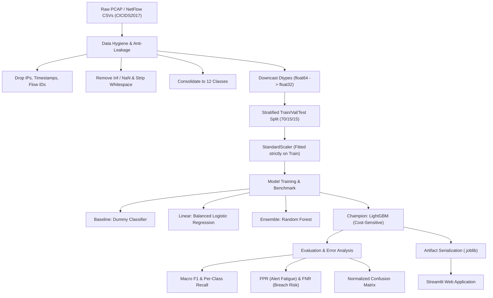

# 🛡️ SentinelFlow: Network Intrusion Detection System Using Supervised Machine Learning

[](https://www.python.org/)
[](https://opensource.org/licenses/MIT)
[](https://www.unb.ca/cic/datasets/ids-2017.html)
[](https://lightgbm.readthedocs.io/)
[](https://streamlit.io/)

A production-grade, interview-ready Machine Learning system that classifies network traffic flows into **BENIGN** or one of **11 distinct cyber attack categories** using the **CICIDS2017** benchmark dataset.

---

## 📌 Project Overview & Objectives
Modern enterprise networks generate millions of packet flows per minute. Identifying sophisticated network attacks—such as volumetric DDoS, stealthy PortScans, slow HTTP socket starvation (Slowloris), and web exploits—requires high-accuracy, low-latency classification with minimal false alarms.

This project implements an end-to-end Machine Learning pipeline:
- **Dataset**: CICIDS2017 (2.8+ million flows, consolidated into 12 standardized classes).
- **Hygiene & Anti-Leakage**: Strips metadata, zero-variance features, and leaky identifiers (`Source IP`, `Timestamp`, etc.).
- **Imbalance Handling**: Employs cost-sensitive learning (`class_weight='balanced'`) to prevent minority attack starvation without generating synthetic noise in high dimensions.
- **Evaluation**: Emphasizes **Macro F1-Score**, **False Positive Rate (FPR)**, and **False Negative Rate (FNR)** to balance threat detection with SOC alert fatigue.
- **Deployment**: Interactive **Streamlit** dashboard for real-time flow simulation and batch CSV traffic triage.

---

## 🏗️ System Architecture



---

## 🎯 12 Target Classes

| # | Traffic Class | Description | Risk Level |
|---|---------------|-------------|------------|
| 1 | **BENIGN** | Normal legitimate enterprise network traffic | Normal |
| 2 | **DoS Hulk** | High-volume HTTP GET/POST flooding | Critical |
| 3 | **PortScan** | Network probing / reconnaissance activity | Medium |
| 4 | **DDoS** | Distributed Denial of Service volumetric flood | Critical |
| 5 | **DoS GoldenEye** | HTTP Keep-Alive connection exhaustion | High |
| 6 | **FTP-Patator** | Brute-force dictionary attack on FTP | Medium |
| 7 | **SSH-Patator** | SSH credential stuffing / brute force | Medium |
| 8 | **DoS slowloris** | Slow connection socket exhaustion attack | High |
| 9 | **DoS Slowhttptest** | Incomplete HTTP requests holding server threads | High |
| 10 | **Bot** | Ares botnet infected host communication | High |
| 11 | **Web Attack** | Consolidated SQL Injection, XSS, and Brute Force | Critical |
| 12 | **Infiltration** | Internal privilege escalation / malware lateral move | Critical |

---

## 📁 Repository Structure

```
├── data/
│   ├── raw/                      # Raw CICIDS2017 CSV files (gitignored)
│   ├── processed/                # Cleaned datasets
│   └── sample_test_flows.csv     # Sample flows for batch testing
├── notebooks/
│   └── 01_master_cicids2017_pipeline.ipynb # Google Colab master notebook
├── src/
│   ├── __init__.py
│   ├── config.py                 # Paths, class maps, leakage definitions
│   ├── data_cleaner.py           # Ingestion, cleaning, downcasting
│   ├── model_trainer.py          # Splitting, pipeline, training, serialization
│   └── evaluate.py               # Metrics, FPR/FNR, confusion matrix
├── models/
│   └── model_metadata.json       # Exported schema & class metadata
├── app/
│   └── app.py                    # Streamlit interactive IDS dashboard
├── docs/
│   └── viva_interview_defense.md # 10 lethal interview Q&A with model answers
├── requirements.txt              # Pinned Python dependencies
└── README.md
```

---

## 🚀 Quick Start Guide

### 1. Clone & Set Up Virtual Environment
```bash
git clone https://github.com/your-username/network-intrusion-detection.git
cd network-intrusion-detection

python -m venv venv
# On Windows:
.\venv\Scripts\activate
# On Linux/macOS:
source venv/bin/activate

pip install -r requirements.txt
```

### 2. Run Experiments in Google Colab
1. Upload `notebooks/01_master_cicids2017_pipeline.ipynb` to [Google Colab](https://colab.research.google.com/).
2. Place the CICIDS2017 CSV files in your Google Drive under `MyDrive/CICIDS2017/`.
3. Execute the cells to clean, train, evaluate, and download the resulting `lightgbm_nids_model.joblib`.
4. Place the downloaded `.joblib` model into the `models/` directory in this repo.

### 3. Launch Streamlit IDS Web Application
```bash
streamlit run app/app.py
```
- Open `http://localhost:8501` in your browser.
- Test single flows using scenario presets (Benign, DDoS, PortScan, Slowloris) or upload `data/sample_test_flows.csv` for batch threat triage.

---

## 💡 Key Engineering Decisions (Interview Highlights)
1. **Zero Data Leakage**: Features like `Source IP`, `Destination IP`, `Timestamp`, and `Flow ID` were dropped immediately. Real IDS models must generalize on packet dynamics, not memorize attacker IP addresses.
2. **Cost-Sensitive Learning over SMOTE**: Rather than generating synthetic packets in 70+ dimensions that violate TCP RFC specifications, we utilized `class_weight='balanced'` in LightGBM to heavily penalize errors on minority classes during tree optimization.
3. **Memory Optimization for Colab**: Features were downcasted from `float64` to `float32` and `int64` to `int32`, cutting RAM footprint in half and preventing OOM crashes in standard Colab environments.
4. **Macro F1 Prioritization**: Accuracy was rejected because predicting 100% Benign gives ~83% accuracy while failing completely at cyber defense. Macro F1 treats all attack classes with equal weight.

For detailed viva and interview questions, see [`docs/viva_interview_defense.md`](docs/viva_interview_defense.md).
