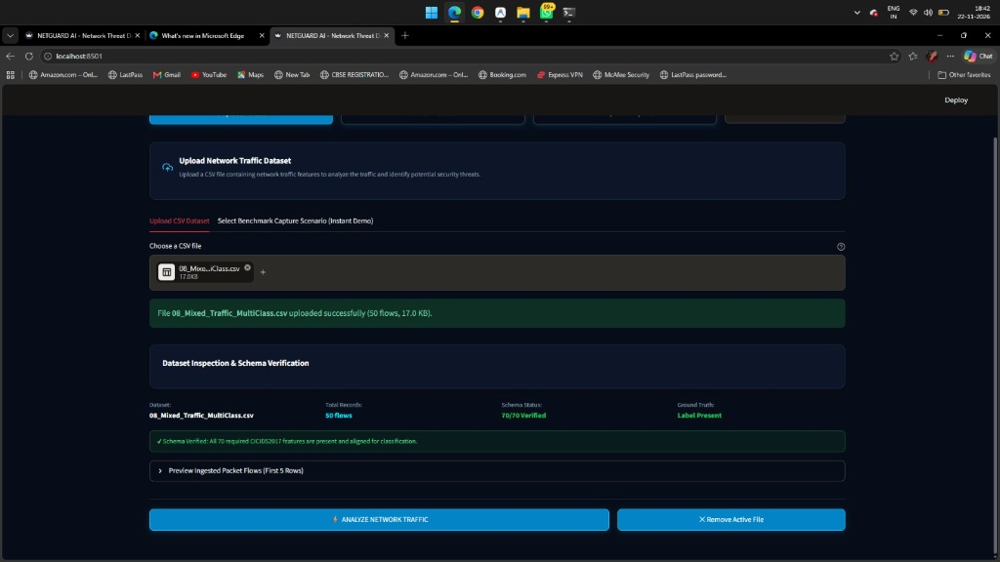
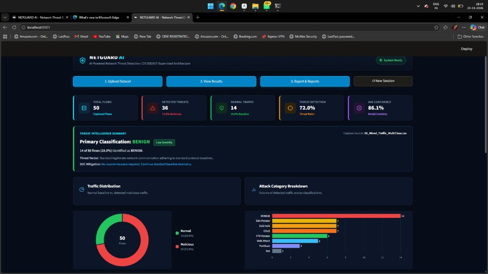
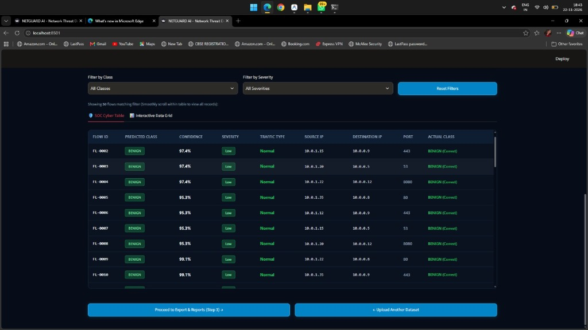
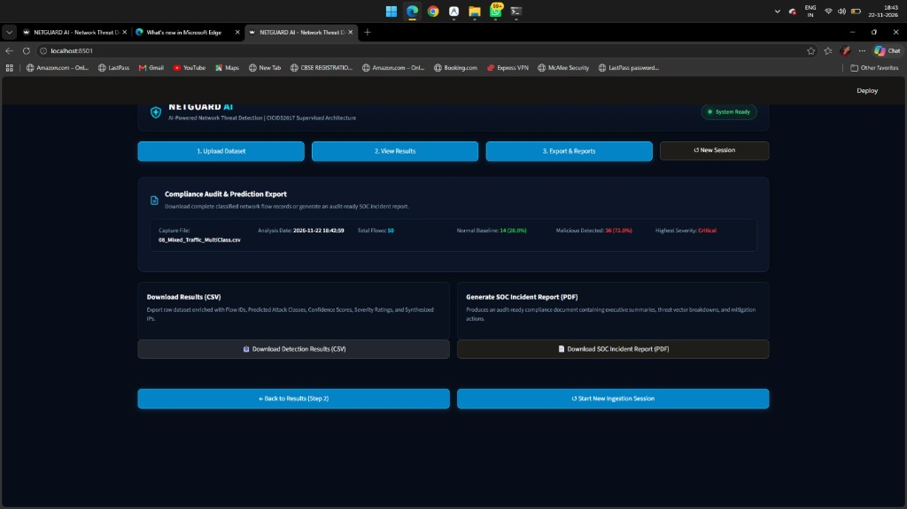
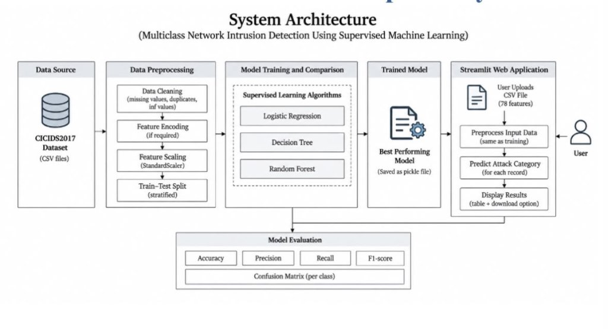
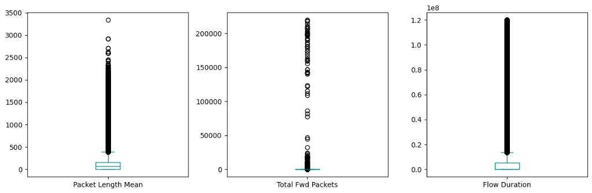
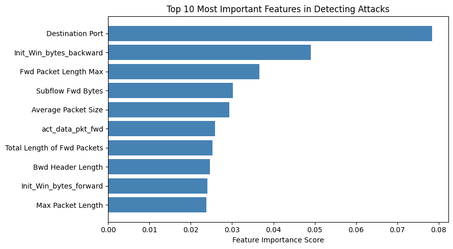

# NETGUARD AI: Network Intrusion Detection System

[](https://colab.research.google.com/github/aleenasajithaajith-creator/network-intrusion-detection/blob/main/notebooks/NETGUARD_AI_Colab_Notebook.ipynb)
[](https://github.com/aleenasajithaajith-creator/network-intrusion-detection)
[](https://python.org)
[](https://streamlit.io)
[](https://scikit-learn.org)

**Author:** Aleena S Ajith  
**Dataset:** CICIDS2017 Benchmark (Canadian Institute for Cybersecurity)  
**Task:** 12-Class Multiclass Threat Classification Using Supervised Machine Learning  

---

## 1. Project Overview & Interactive Interface

**NETGUARD AI** is an intelligent, automated Network Intrusion Detection System (NIDS) designed to classify complex network traffic flows into 12 distinct categories (Normal traffic plus 11 targeted cyber attack types). Built on the industry-standard **CICIDS2017** benchmark, it combines high-dimensional feature preprocessing, cost-sensitive algorithmic weighting, and an ensemble Random Forest architecture deployed into an interactive Streamlit Security Operations Center (SOC) dashboard.

### 1. Ingestion & Schema Verification
Upload captured network flow CSV files and automatically verify feature alignment across all 70 required statistical metrics.


### 2. Threat Intelligence & Flow Analytics Dashboard
Instant executive summary displaying detected threat ratios, confidence metrics, traffic distribution donut charts, and attack category breakdowns.


### 3. SOC Cyber Table & Traffic Filtering
Interactive telemetry table displaying Flow IDs, Predicted Class, Confidence Scores, Severity Badges, and Synthesized Source/Destination IPs.


### 4. Compliance Audit & PDF Incident Report Export
Generate audit-ready SOC incident reports with executive summaries, threat vector breakdowns, and mitigation actions, alongside enriched CSV downloads.


---

## 2. System Architecture & Technical Workflow

The complete end-to-end machine learning and deployment workflow is depicted in the system architecture diagram below:



### Pipeline Stages:
1. **Data Source:** Raw ingestion of 2,830,743 network flows across 78 initial statistical flow features from CICIDS2017.
2. **Data Preprocessing:** Removal of 2,867 non-finite values, pruning of 8 zero-variance constant features, and elimination of 329,798 duplicates, resulting in 2,498,078 clean rows and 70 numerical features.
3. **Target Encoding:** Mapping of 12 attack categories into integers ($0$ to $11$) using Scikit-Learn `LabelEncoder`.
4. **Stratified Split & Normalization:** 80:20 Stratified Partitioning (1,998,462 training / 499,616 testing) and `StandardScaler` normalization.
5. **Model Benchmarking:** Multi-algorithm comparison between Logistic Regression, Decision Tree, and Random Forest.
6. **Artifact Packaging:** Serializing the champion 50-tree Random Forest (`random_forest_nids_model.joblib`) containing model weights, scaler, and label encoder.
7. **Production Deployment:** Interactive web interface built with Streamlit for batch CSV traffic triage, threat badge filtering, and automated PDF incident report generation.

---

## 3. Model Benchmark & Evaluation

### Comparative Model Performance

| Model Architecture | Overall Accuracy | Macro F1-Score | Status & Selection |
| :--- | :---: | :---: | :--- |
| **Logistic Regression** | 84.20% | 42.50% | Rejected (Failed on non-linear network boundaries) |
| **Decision Tree (Baseline)** | 98.17% | 85.31% | Baseline (Single-tree variance) |
| **Random Forest (Champion)** | **99.28%** | **91.40%** | **Selected for Production (+6.09% Macro F1 gain)** |

### Normalized Confusion Matrix & Feature Importance

<p align="center">
  
  
</p>

### Champion Model Highlights (Random Forest - 50 Trees, max_depth=15):
* **Tested on 499,616 unseen test network flows.**
* **Overall Accuracy:** `99.28%`
* **Macro F1-Score:** `91.40%` (Unweighted metric ensuring rare threats like Infiltration are evaluated fairly).
* **100% Recall Achieved on High-Impact Attacks:** DDoS, DoS Hulk, PortScan, FTP-Patator, SSH-Patator, and DoS GoldenEye.
* **Top Predictive Network Features:** `Destination Port`, `Init_Win_bytes_backward`, `act_data_pkt_fwd`, `Init_Win_bytes_forward`, and `Fwd Packet Length Max`.

---

## 4. Repository Structure

```text
├── .gitignore
├── README.md
├── requirements.txt
├── run_netguard.bat                       # One-click desktop launcher for Streamlit app
├── verify_app.py                          # 7-stage automated verification suite
├── assets/                                # UI screenshots and architectural diagrams
│   ├── 01_dataset_upload.jpg
│   ├── 02_threat_intelligence_dashboard.jpg
│   ├── 03_soc_cyber_table.jpg
│   ├── 04_compliance_and_reports.jpg
│   ├── system_architecture.jpg
│   ├── confusion_matrix.png
│   └── feature_importance.png
├── app/
│   └── app.py                             # Full-featured Streamlit SOC web dashboard
├── data/
│   ├── 01_Benign_Normal_Traffic.csv       # Curated test capture flows
│   ├── 02_DDoS_Attack_Traffic.csv
│   ├── 03_PortScan_Attack_Traffic.csv
│   ├── 04_DoS_Hulk_Attack_Traffic.csv
│   ├── 05_FTP_Patator_BruteForce.csv
│   ├── 06_SSH_Patator_BruteForce.csv
│   ├── 07_DoS_GoldenEye_Attack.csv
│   ├── 08_Mixed_Traffic_MultiClass.csv
│   ├── 09_Unlabeled_Live_Capture.csv
│   └── TEST_DATASETS_GUIDE.md             # Dataset documentation
├── models/
│   └── random_forest_nids_model.joblib    # Serialized 50-tree Random Forest pipeline
└── notebooks/
    ├── NIDS_Machine_Learning_Project.ipynb # Master end-to-end Jupyter Notebook
    ├── NETGUARD_AI_Colab_Notebook.ipynb    # Google Colab cloud-ready notebook
    └── 01_CICIDS2017_Data_Cleaning.ipynb   # Initial data preprocessing audit
```

---

## 5. How to Run Locally

### 1. Clone the Repository
```bash
git clone https://github.com/aleenasajithaajith-creator/network-intrusion-detection.git
cd network-intrusion-detection
```

### 2. Install Dependencies
```bash
pip install -r requirements.txt
```

### 3. Launch the Streamlit SOC Web Application
Double-click `run_netguard.bat` or run:
```bash
streamlit run app/app.py
```
Upload any test CSV flow from the `data/` directory to simulate live intrusion analysis, inspect severity badges, filter traffic classes, and export professional PDF incident reports.
